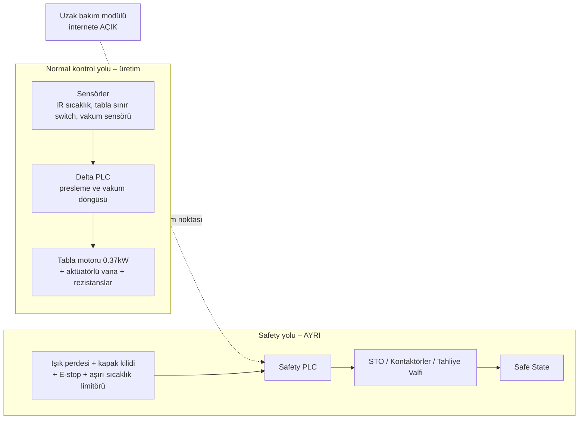

# Lab 1 – Safety Architecture

**Makine:** Mergen MPL.II.AUTO Otomatik Vakum Membran Pres · **Çıktı:** Safety Function Map → EP 03 Safety Functions

## Safety Function Map

## Cevaplar

**1. Bu makinede tehlike nedir? İnsan neyden zarar görür?**
- Kramiyer-pinyon tahrikli 1400x3100 mm ağır metal tablanın içeri/dışarı sürülmesi sırasında operatörün kolu, bacağı veya gövdesi tabla ile şasi arasına sıkışıp ezilebilir.
- 620 mm 190V 600W rezistans grubu PVC/termoform folyoyu ısıtırken 130°C–180°C sıcaklığa ulaşır; temas halinde ağır 3. derece termal yanık, kontrolsüz çalışmada ise yangın riski vardır.
- 111 m³/saat vakum pompası ve 1'' aktüatörlü vana ile çalışan pres haznesi kapanırken operatör folyo düzeltmeye çalışırsa uzuv kapılması ve pres altında ezilme meydana gelebilir.

**2. Safety function hangisidir?**
Tabla hareket hattındaki ışık perdesi kesildiğinde, pres kapağı açıldığında, aşırı sıcaklık limitörü tetiklendiğinde veya Acil Stop butonuna basıldığında; tabla tahrik motoru STO (Safe Torque Off) ile anında durdurulur, rezistansların ana besleme kontaktörü düşürülür ve aktüatörlü vana vakum hattını atmosfere tahliye eder. Manuel reset yapılmadan makine yeniden başlamaz.

**3. Safety-related control system nerede?**
Alt şerit: Işık perdesi + kapak güvenlik switch'i + E-stop + mekanik aşırı sıcaklık emniyet termostatı → Safety PLC → Sürücü STO / Motor ana kontaktörü + Rezistans ana kontaktörü + Emniyet tahliye valfi.

**4. Normal PLC ile Safety PLC farkı nedir?**
Normal Delta PLC; folyo sarma/presleme sürelerini, kramiyer-pinyonlu tablanın ileri-geri hareket dizisini, IR sensöründen gelen sıcaklığa göre rezistans PID kontrolünü ve vakum vanasının açılıp kapanmasını yönetir; tek kanallıdır. Safety PLC ise donanımsal çift kanallıdır (1oo2 / 2oo2), sürekli kendi kendini denetler (cross-monitoring & self-diagnostics), tek bir dahili arıza durumunda dahi güvenli duruma geçer ve fonksiyonel güvenlik standardı (ISO 13849-1 / IEC 62061) sertifikalıdır.

**5. PLr / SIL neden var? Bu fonksiyon için neden önemli?**
Fonksiyonun ne kadar güvenilir olması gerektiğini risk analizine göre belirler. Membran preste operatör plaka yükleme, folyo serme ve kalıp ayarı için tabla çalışma sahasına her çevrimde doğrudan yaklaşır. Tablaya sıkışma veya yüksek sıcaklıktaki rezistansla temas kalıcı ağır yaralanmalara yol açabilir → **PLr d / SIL 2**.

**6. Safe state nedir?**
Kramiyer-pinyon tahrikli metal tabla durur ve mekanik fren devreye girer; rezistansların elektrik beslemesi ana kontaktörden fiziksel olarak kesilir; vakum hattı atmosfere tahliye edilerek negatif basınç sıfırlanır; sesli/görsel ikaz devreye girer ve operatör fiziksel reset butonuna basmadıkça makine kendiliğinden asla yeniden başlayamaz.

**7. Safety function hangi dijital bağımlılıklara sahip?**
Safety PLC lojik yazılımı, ışık perdesi muting ayarları (tablanın otomatik geçişinde insanın ayırt edilmesi mantığı), Delta HMI emniyet parametreleri, sürücü STO konfigürasyonu ve internete açık uzak bakım modülü.

**8. Siber müdahale hangi noktadan bu fonksiyonu bozar?**
Uzak bakım modülü → Safety PLC köprüsü. Saldırgan uzak bakım modülü üzerinden erişim sağlayarak ışık perdesinin muting parametresini veya emniyet lojiğini bypass ederse, operatör folyo hizalaması yaparken metal tabla içeri sürülür, rezistanslar kontrolsüz ısınır ve operatör pres hücresinde sıkışır.

