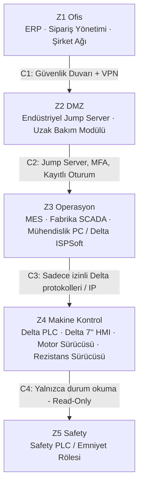

# Lab 2 – IEC 62443 Mini Workshop

**Makine:** Mergen MPL.II.AUTO Otomatik Vakum Membran Pres · **Çıktı:** Zone / Conduit Diagram → EP 05 Zone & Conduit

## Zone / Conduit Diagram

## Görev A

**1. Hangi varlıklar aynı bölgede?**
- **Z1 Ofis:** ERP sistemi, sipariş ve stok veri tabanı, ofis bilgisayarları ve e-posta sunucuları.
- **Z2 DMZ (Demilitarized Zone):** Dış dünyaya kontrollü bakan Endüstriyel Jump Server ve yetkilendirilmiş uzak bakım ağ geçidi (IoT Gateway).
- **Z3 Operasyon:** Üretim Yönetim Sistemi (MES), fabrika SCADA sunucusu ve Delta PLC/HMI programlama istasyonu (ISPSoft / DOPSoft mühendislik PC'si).
- **Z4 Makine Kontrol:** Delta PLC, Delta 7'' dokunmatik operatör paneli (HMI), kramiyer motor sürücüsü, 1'' aktüatörlü vakum vanası röleleri ve IR sıcaklık kontrol modülü.
- **Z5 Safety:** Işık perdelerini, E-stop butonlarını, pres kapağı switch'ini ve rezistans termik limitörünü yöneten Safety PLC / güvenlik modülü.

**2. Safety PLC hangi bölgede – neden?**
Ayrı ve en yüksek koruma düzeyine sahip bölgede (Z5). 1400x3100 mm boyutundaki ağır metal tablanın ezme hareketine, 180°C rezistans grubunun termal yanık tehlikesine ve vakum presinin oluşturduğu mekanik risklere karşı operatörü doğrudan koruyan unsurdur. Kurumsal ofis ağı veya üretim ağı fidye yazılımı ya da saldırganlarca ele geçirilse bile emniyet zincirine doğrudan ulaşılamamalı ve fonksiyon devre dışı bırakılamamalıdır.

**3. Conduit'ler nerede, ne kontrol edilecek?**
- **C1 Ofis ↔ DMZ:** Güvenlik duvarı (Firewall) ve VPN denetimi. Ofis katmanından makine kontrol katmanına doğrudan hiçbir geçişe izin verilmez.
- **C2 DMZ ↔ Operasyon:** Jump server üzerinden güvenli RDP/SSH tünelleme, çok faktörlü kimlik doğrulama (MFA) ve video/komut düzeyinde oturum kaydı.
- **C3 Operasyon ↔ Makine:** Yalnızca tanımlı endüstriyel haberleşme protokolleri (Modbus TCP, Ethernet/IP) ve belirlenmiş MAC/IP eşleşmeleri. Genel internet veya kontrol dışı paketler engellenir.
- **C4 Makine ↔ Safety:** Yalnızca tek yönlü durum okuma (Read-only status: E-stop basılı mı, ışık perdesi devrede mi). Uzaktan program indirme, parametre yazma veya lojik baypas kesinlikle engellenir; programlama yalnızca sahada fiziksel kilit anahtarı ile yapılabilir.

## Görev B – Uzak Erişim Kararı

| Karar | Seçim | Neden |
|---|---|---|
| **Aracı** | Endüstriyel Jump Server | Uzak bakım modülü doğrudan fabrika kontrol ağına veya PLC'ye köprülenmez; tüm bağlantılar izole bir ara sunucuda sonlanır. |
| **Tünel** | IPSec / WireGuard VPN | Fabrika dışından gelen tüm trafik güçlü kriptografik şifreleme ile güvenceye alınır. |
| **Kimlik** | Donanımsal / TOTP Çok Faktörlü Doğrulama (MFA) | Servis teknisyeninin parolasının sızması veya tahmin edilmesi durumunda yetkisiz girişi engeller. |
| **Hesap** | Kişisel / Adlandırılmış Kullanıcı Hesapları | Ortak "admin" veya "servis" hesapları kapatılır; hangi teknisyenin hangi parametreyi değiştirdiği netleştirilir. |
| **Kayıt** | Tam Oturum ve Komut Kaydı | Olası bir hatalı reçete veya güvenlik arızasında geriye dönük adli delil ve denetim izi sunar. |
| **Zamanlama** | Varsayılan Kapalı (On-Demand / Süre Kısıtlı) | Bağlantı 7/24 açık bırakılmaz; yalnızca fabrika bakım sorumlusunun onayladığı iş emri süresince açılır ve otomatik sonlanır. |
