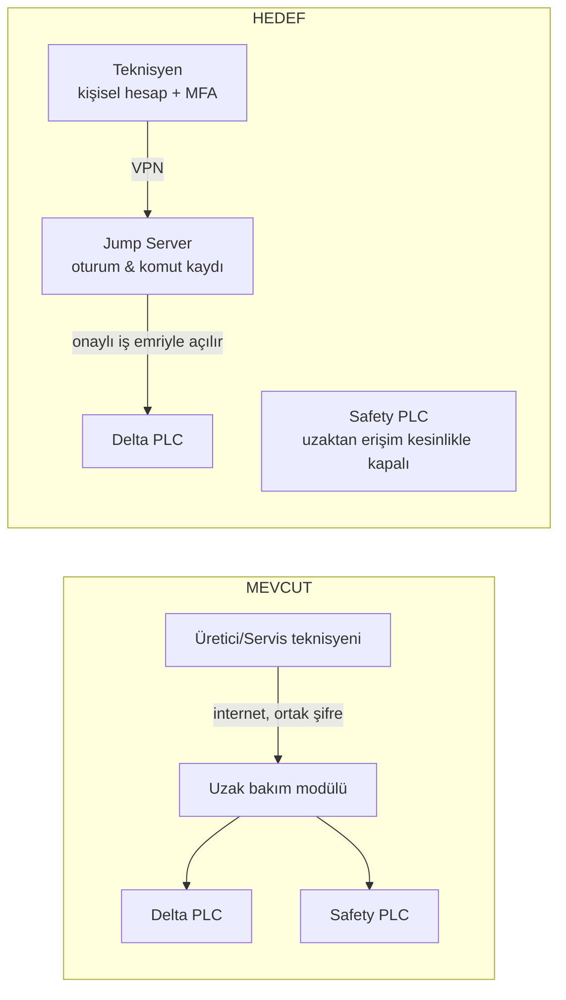

# Lab 4 – Secure Remote Access

**Makine:** Mergen MPL.II.AUTO Otomatik Vakum Membran Pres · **Çıktı:** Secure Architecture → EP 02 + EP 06

## Görev A – Mevcut → Hedef

**MEVCUT DURUM:**
- Servis sağlayıcı veya fabrika bakımcısı, internete doğrudan açık durumdaki endüstriyel uzak bakım modülüne paylaşımlı ortak servis parolasıyla bağlanmaktadır.
- Çok faktörlü doğrulama (MFA) bulunmamakta, oturumlar kaydedilmemekte ve uzak erişim kapısı 7/24 kesintisiz açık durmaktadır.
- Uzak bakım modülü üzerinden Delta PLC'nin yanı sıra emniyet devresine (Safety PLC / Muting ayarları) doğrudan ağ erişimi mevcuttur.

**HEDEF (Beş İlke):**
1. **Ara Nokta:** Dışarıdan makine kontrol ağına doğrudan geçiş kapatılmış; tüm erişimler DMZ bölgesindeki denetimli Endüstriyel Jump Server üzerinde toplanmıştır.
2. **Kriptografik VPN:** Tüm bağlantılar açık internet yerine uçtan uca şifreli VPN tüneli üzerinden kurulur.
3. **MFA (Çok Faktörlü Doğrulama):** Parola sızıntılarına karşı donanımsal token veya mobil TOTP zorunlu kılınmıştır.
4. **Kişisel Hesap ve Tam Oturum Kaydı:** Ortak hesaplar yasaklanmış, her operatör ve mühendise adlandırılmış hesap atanmış; oturum boyunca yapılan tüm ekran ve parametre hareketleri video/log olarak kayıt altına alınmıştır.
5. **Varsayılan Kapalı (On-Demand / Süre Kısıtlı):** Uzak erişim kapısı sürekli kapalı tutulur; yalnızca planlı bakım iş emri açıldığında tesis yöneticisinin onayıyla belirli bir süre (örneğin 2 saat) için aktif edilir ve süre sonunda otomatik kapanır.

## Görev B – Functional Safety Köprüsü

**1. Saldırgan tüm siber önlemlere rağmen içeri girerse emniyet fonksiyonu etkilenir mi?**
- **Safety yolu tamamen bağımsız ise etkilenmez:** Operatör ışık perdesini kestiğinde veya Acil Stop'a bastığında, donanımsal güvenlik kontaktörleri ve sürücü STO hattı; Delta PLC ve uzak erişim yazılımından bağımsız olarak tabla motorunun gücünü, 190V 600W rezistans beslemesini ve vakum basıncını derhal keser.
- **Ancak Safety PLC'ye uzaktan erişim ve muting baypas izni verilmişse etkilenir:** Saldırgan yazılımsal muting lojiğini tetikleyerek emniyet perdelerini devre dışı bırakabilir ve ölümcül kazaya yol açabilir. Bu nedenle Safety hattına uzaktan yazma yetkisi kesinlikle kapatılmalıdır.

**2. Güvenlik ve Emniyet Gereksinimi:**
> *"Emniyet fonksiyonu (kramiyer-pinyon tablanın durdurulması, rezistans enerjisinin kesilmesi ve vakum tahliyesi); Delta PLC, HMI veya uzak erişim modülü tamamen ele geçirilse dahi tablayı durdurabilmeli ve operatörü koruyabilmelidir. Emniyet parametreleri ve muting lojiği hiçbir koşulda uzaktan değiştirilememeli, yalnızca fiziksel kilit anahtarı ile sahada ve yetkiyle yapılandırılabilmelidir."*

> Tarafsızlık notu: Bu föy çözüm tasarlatmaz; gereksinimi tanımlatır.

